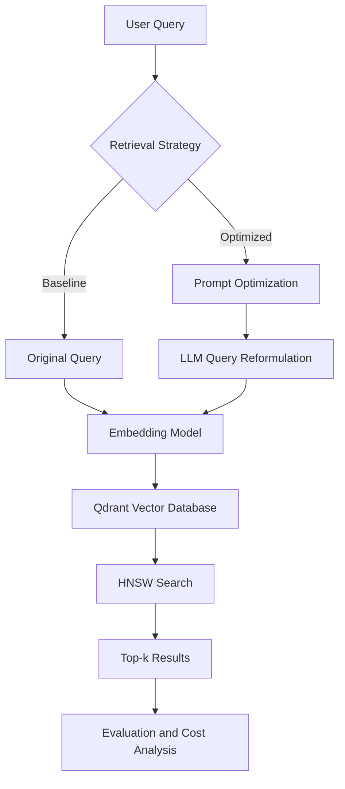

# Cost-Aware Prompt Optimization for HNSW-Based Vector Search

A cost-aware prompt optimization framework for HNSW-based vector search, designed to balance retrieval accuracy, latency, and computational cost through intelligent prompt engineering.

## Overview

Vector search enables semantic retrieval of relevant documents using embeddings, while HNSW (Hierarchical Navigable Small World) enables efficient approximate nearest-neighbor search.

This project explores whether prompt-based query optimization can improve retrieval quality while controlling LLM token usage, latency, and API costs.

The system compares conventional vector search with prompt-optimized search to evaluate the trade-offs between retrieval quality and cost.

## Objectives

- Implement HNSW-based semantic search.
- Develop prompt templates for query reformulation.
- Compare baseline and prompt-optimized retrieval.
- Measure retrieval quality, latency, and LLM costs.
- Investigate when query optimization is worth its additional expense.

## System Architecture



### Workflow

1. Load documents and generate embeddings.
2. Store embeddings in Qdrant using an HNSW index.
3. Process queries using baseline or prompt-optimized retrieval.
4. Retrieve the top-k most relevant documents.
5. Compare retrieval quality, latency, and cost.

## Tech Stack

- **Language:** Python
- **Vector Database:** Qdrant
- **Indexing:** HNSW
- **Embeddings:** Sentence Transformers (`all-MiniLM-L6-v2`)
- **Prompt Optimization:** Structured prompts with an optional LLM API
- **Evaluation:** NumPy, Pandas, Matplotlib

## Evaluation Metrics

| Metric | Purpose |
|---|---|
| Recall@k | Measures retrieval completeness |
| Precision@k | Measures relevance of retrieved results |
| Query latency | Measures processing and retrieval time |
| Token usage | Measures LLM consumption |
| Estimated API cost | Measures the cost of query optimization |

The baseline and optimized approaches will use the same dataset, embedding model, and HNSW configuration for a fair comparison.

## Project Structure

```text
hnsw-prompt-optimizer/
├── data/
├── src/
│   ├── ingestion.py
│   ├── embeddings.py
│   ├── vector_store.py
│   ├── prompt_optimizer.py
│   ├── retrieval.py
│   ├── cost_estimator.py
│   └── evaluation.py
├── experiments/
├── tests/
├── main.py
├── requirements.txt
├── .env.example
└── README.md
```

## Getting Started

### 1. Clone the repository

```bash
git clone https://github.com/YOUR_USERNAME/hnsw-prompt-optimizer.git
cd hnsw-prompt-optimizer
```

### 2. Create a virtual environment

```bash
python3 -m venv .venv
source .venv/bin/activate
```

On Windows, activate it using `.venv\Scripts\activate`.

### 3. Install dependencies

```bash
pip install -r requirements.txt
```

### 4. Run the project

```bash
python main.py
```

An external LLM API key is required only if the selected query optimization implementation uses a hosted LLM provider. Configure credentials through environment variables and never commit secrets.

## Expected Outcomes

The experiments aim to determine whether prompt-based query reformulation improves retrieval quality, whether the improvement justifies additional LLM costs, and whether selectively optimizing queries can reduce unnecessary expenditure.

All performance improvements will be established through experiments rather than assumed beforehand.

## Future Scope

- Adaptive HNSW parameter selection.
- Query optimization based on query complexity.
- Prompt-template and embedding-model comparisons.
- Query caching to reduce repeated API calls.
- Integration with retrieval-augmented generation (RAG).

## License

MIT License (subject to applicable dataset and dependency licenses).
